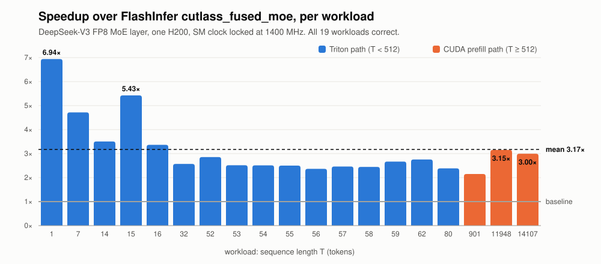

# MoE-Swarm

Claude Code agents that optimize CUDA/Triton kernels. DeepSeek-V3 FP8 MoE: 3.17x faster than FlashInfer's CUTLASS.

Seven agents per round compete on the FP8 fused-MoE layer of DeepSeek-V3, on one NVIDIA H200.
The speedup over `cutlass_fused_moe` is averaged over the 19 workloads of the
[MLSys 2026 FlashInfer contest](https://github.com/flashinfer-ai/flashinfer-bench) (Track A),
all 19 correct.

The repo holds the agent harness and the kernel it produced. The harness is built around this
one kernel's spec; pointing it at another kernel means writing a new spec and roofline model
for it.

<picture>
  <source media="(prefers-color-scheme: dark)" srcset="docs/img/speedup-dark.svg">
  
</picture>

Speedup is the mean of `baseline_latency / our_latency` over the 19 workloads, measured on one
H200 with the SM clock locked at 1400 MHz. The contest's own baseline (TRT-LLM) runs only on
Blackwell, so these numbers are not comparable with the contest leaderboard. On the largest
prefill workload the call drops from 2383 to 1580 µs, with both GEMMs above 1 PFLOP/s.

Where the speed came from:

| step | score | what changed |
|---|---|---|
| PyTorch port of the reference | 0.13× | dequantizes each expert's weights to bf16 before every matmul |
| Triton kernel, first agent rounds | 2.84× | FP8 weights read from HBM once, no dequantized copy, fused SwiGLU and combine, no host syncs, CUDA graph |
| three more agent rounds | 3.01× | launch overhead, tile shapes, the combine epilogue |
| hand-written CUDA prefill path | 3.17× | warp-specialized TMA + wgmma for T ≥ 512 |

Most of the gain is the first jump, and it is about memory traffic. Before every matmul, v1
converted each active expert's FP8 weights into a bf16 copy in HBM: 1 byte read, 2 bytes
written, 2 bytes read back, so 5 bytes of HBM traffic per weight. The Triton kernel loads
the FP8 weights through L2 and shared memory into the tensor cores and never writes a copy
back, so each weight costs 1 byte. Later agent rounds added 6%. The last 5% needed a CUDA
path that no agent managed to build in its 90 minutes.

<details>
<summary>Per-workload speedup as a table</summary>

| T | 1 | 7 | 14 | 15 | 16 | 32 | 52 | 53 | 54 | 55 |
|---|---|---|---|---|---|---|---|---|---|---|
| × | 6.94 | 4.72 | 3.51 | 5.43 | 3.37 | 2.57 | 2.85 | 2.52 | 2.51 | 2.50 |

| T | 56 | 57 | 58 | 59 | 62 | 80 | 901 | 11948 | 14107 |
|---|---|---|---|---|---|---|---|---|---|
| × | 2.36 | 2.46 | 2.45 | 2.67 | 2.76 | 2.39 | 2.15 | 3.15 | 3.00 |

</details>

## The problem

`moe_fp8_block_scale_ds_routing_topk8_ng8_kg4_e32_h7168_i2048`: route each token to 8 of 256
experts, run the 32 experts local to this rank (GEMM1 `[T,7168]×[7168,4096]`, SwiGLU, GEMM2
`[T,2048]×[2048,7168]`), and combine. Weights and activations are FP8 with 128×128 block
scales. T ranges from 1 to 14107.

For a weight-dominated GEMM the arithmetic intensity is about 2 FLOPs per byte per token
routed to the expert. Up to T=901 (about 28 tokens per expert) that is far below the ridge
point of any current GPU, so 17 of the 19 workloads are bound by bytes moved, not FLOPs.
The kernel's job is to read each needed expert's weights once, in FP8, and read no others:
at T=1 that is 3 of 32 experts. The roofline numbers are in [`docs/DESIGN.md`](docs/DESIGN.md).

## The kernel

`solution/python/kernel.py`, one file, two paths.

**T < 512, Triton.** Four kernels: route, GEMM1, an optional split-K reduce, GEMM2.

- Each GEMM builds its work list from the routing counts in-kernel, so idle experts get no
  CTAs.
- FP8 weights are loaded from HBM through shared memory into FP8 tensor-core MMAs, with no
  dequantized copy; block scales are applied to the fp32 accumulator once per K block.
- SwiGLU is fused into GEMM1 and the expert combine into GEMM2's epilogue, so neither
  intermediate reaches HBM.
- The kernels replay as one CUDA graph, removing Python dispatch from the call.
- At small T, narrow tiles and split-K add CTAs without reading extra bytes.

**T ≥ 512, CUDA.** A grouped GEMM adapted from [DeepGEMM](https://github.com/deepseek-ai/DeepGEMM)
(MIT), compiled on first call. A TMA producer warp feeds two wgmma warpgroups, with 2-CTA TMA
multicast, overlapped scale promotion, and SwiGLU plus FP8 requantization fused into GEMM1's
epilogue.

[`docs/KERNELS.md`](docs/KERNELS.md) has per-kernel timings, what each change bought, and
what didn't work.

## The swarm

`swarm.py` runs rounds. Each round re-measures the two surviving kernels and starts 7 agents,
each in its own git worktree with a different strategy hint (`small_t_parallelism`,
`warp_specialize`, ..., and one freestyle). An agent may change only
`kernel.py` and gets 90 minutes. Then `swarm.py` checkpoints every candidate to git,
re-measures each one in a clean subprocess, ranks them on a quick benchmark, runs the full
benchmark on the top 3, and keeps 2 as seeds for the next round.

`bench.py` wraps the official `flashinfer-bench` scorer and adds a per-workload roofline
verdict, so an agent sees why a workload is slow, not only that it is:

```
T=1: memory-bound (182x). Routing activates 3 of 32 local experts -> 132 MB minimum
traffic; floor 32 us, measured 70 us = 46% of speed-of-light.
```

`gates.py` rejects reward hacking before anything is timed: calling a kernel library,
ignoring the inputs, or caching results across calls. Each gate has an illegal fixture in
`cheats/` and a test that it trips on that fixture and on nothing else.

What five rounds showed about the agents:

- **Turns are the bottleneck, not the GPU or the clock.** The GPU sat ~40% idle during the
  agent phase, and raising the timeout from 5400 s to 7200 s made a round worse (24
  benchmark runs instead of 38, +1.0% instead of +2.6%). What helps is making each
  iteration cheaper: agents kept writing their own subset benchmarks, so `bench.py --only`
  now provides one.
- **Agents tune; they didn't restructure.** Three rounds of launch-overhead and tiling work
  added 6%. None produced the warp-specialized CUDA prefill path in 90 minutes; that took one
  long dedicated session.

## Measuring it

Most of the hard bugs were in measurement, not in the kernel:

- **Lock the SM clock.** Unlocked, clock ramp made one kernel's runs spread 115%; locked,
  0.18%. Nsight Compute overrides the lock unless you pass `--clock-control none`.
- **Profile the way the harness times.** `flashinfer-bench` flushes L2 with a memset and
  syncs before every call. A back-to-back profiling loop skips that cost and overstates the
  kernel; `scripts/profile_small_t.py` reproduces the harness.
- **Check the baseline, not only your kernel.** One run mis-measured the baseline on a single
  workload and inflated a recorded score by 18%. `swarm.py` audits recorded baselines before
  every round.
- **Let the metric set priorities.** The score is a mean of speedup ratios, so a microsecond
  saved where you're already 6.9× faster counts about 3× more than where you're 2.4×.

Details and numbers: [`docs/DESIGN.md`](docs/DESIGN.md) section 3 and [`docs/KERNELS.md`](docs/KERNELS.md).

## Running it

Linux, an H100 or H200, CUDA 12.8+, PyTorch with CUDA, and root for the clock lock. The
agents need [Claude Code](https://docs.anthropic.com/en/docs/claude-code) and an Anthropic
API key.

Fork the repo before running `swarm.py`. It pushes results to a `swarm-results` branch on
`origin` after every round and stops if the push fails, so a clone without push access loses
its first round.

```bash
bash scripts/node-setup.sh && source ~/ks-env.sh   # dataset, clock lock, calibration
python bench.py --light --prompt-view              # score and roofline verdict
python bench.py --light --only 1,7,15              # subset, for fast iteration
python swarm.py --rounds 1 --parallel 7 --agent-timeout 5400 --dry-run   # setup check, no agents (~10 min)
python swarm.py --rounds 1 --parallel 7 --agent-timeout 5400             # ~2 h 45 m
```

The first `bench.py` run compiles the CUTLASS baseline, which takes about 70 minutes.
`python test_kernel.py` checks routing and scale handling on CPU, without a GPU.

```
solution/python/kernel.py   the kernel
bench.py                    scorer + roofline verdict
swarm.py                    round loop
gates.py, cheats/           anti-cheat gates and their fixtures
scripts/                    setup, results sync, profiling
spec/                       the contest's definition and reference, verbatim
docs/                       design, kernel history, GPU primer
```

## Next

- swap-AB at small M (weights as wgmma's M, tokens as N), so decode drops the FP8→FP16 conversions
- fold GEMM1's split-K reduction into its last CTA and drop a kernel
- one persistent kernel for the whole layer, with programmatic dependent launch
- a B200 (sm_100a) port: tcgen05 and tensor memory
- ncu stall data in the agents' feedback, next to the roofline verdict
- lessons that carry across rounds, so agents stop retrying dead ends
- more GPUs, giving each agent its own timing slot
- the same loop on attention kernels

## References

- [flashinfer-bench](https://github.com/flashinfer-ai/flashinfer-bench) and the [mlsys26-contest dataset](https://huggingface.co/datasets/flashinfer-ai/mlsys26-contest)
- [DeepSeek-V3 technical report](https://arxiv.org/abs/2412.19437), [DeepGEMM](https://github.com/deepseek-ai/DeepGEMM), [CUTLASS](https://github.com/NVIDIA/cutlass)
- [KernelBench](https://github.com/ScalingIntelligence/KernelBench), [KernelAgent](https://github.com/meta-pytorch/KernelAgent), [MIT HAN Lab's contest entry](https://github.com/mit-han-lab/mlsys2026-flashinfer-contest)

## License

MIT. Third-party code keeps its own license; see [THIRD_PARTY_NOTICES.md](THIRD_PARTY_NOTICES.md).
