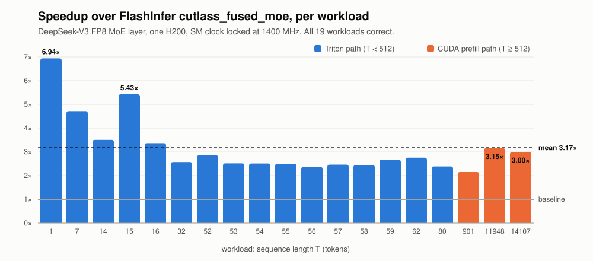
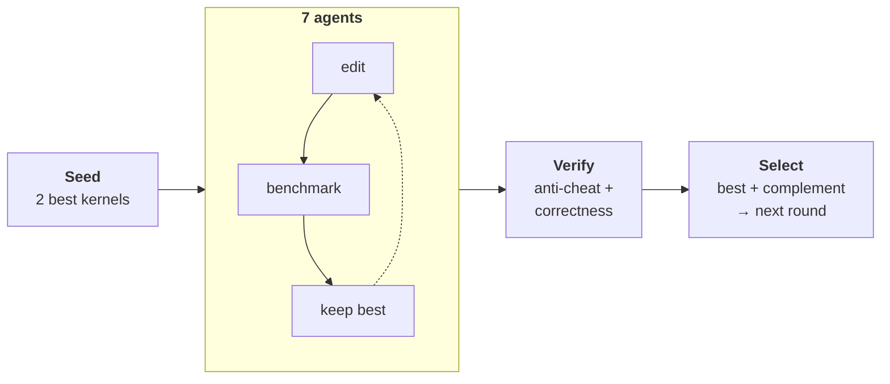

# MoE-Swarm

Claude Code agents that optimize CUDA/Triton kernels. DeepSeek-V3 FP8 MoE: 3.17x faster than FlashInfer's CUTLASS.

A harness that runs seven Claude Code agents per round against one GPU kernel, keeps the two
best kernels as seeds for the next round, and repeats. Pointed at the FP8 fused-MoE layer of
DeepSeek-V3 on one NVIDIA H200, it produced a kernel 3.17× faster than FlashInfer's
`cutlass_fused_moe`, averaged over the 19 workloads of the
[MLSys 2026 FlashInfer contest](https://github.com/flashinfer-ai/flashinfer-bench) (Track A),
all 19 correct.

<picture>
  <source media="(prefers-color-scheme: dark)" srcset="docs/img/speedup-dark.svg">
  
</picture>

Speedup is the mean of `baseline_latency / our_latency` over the 19 workloads, measured on one
H200 with the SM clock locked at 1400 MHz. The contest's own baseline (TRT-LLM) runs only on
Blackwell, so these numbers are not comparable with the contest leaderboard.

## How it works



**Agents.** Each agent gets one strategy hint, a roofline verdict telling it what bounds each
workload, and the other surviving kernel as reference. It may change only `kernel.py`, measures
as often as it likes, and its best version is kept automatically, so it never hands back a
regression.

**Strategy.** Most hints target what the roofline and the score weight most; one agent is
freestyle. Agents alternate between the two kernel lineages. The survivors are the best kernel
and the one that best complements it, so a kernel that wins a different region isn't lost.

**Evaluation.** The official contest scorer checks correctness and speedup. A quick benchmark
drives the agents; a full one confirms the finalists. Anti-cheat gates run before any timing,
and the GPU clock is locked so measurements are repeatable. Kernels are profiled with Nsight
Systems and Nsight Compute; `scripts/` reproduces the harness's timing for nsys.

## Running it

Linux, an H100 or H200, CUDA 12.8+, PyTorch with CUDA, and root for the clock lock. The
agents need [Claude Code](https://docs.anthropic.com/en/docs/claude-code) and an Anthropic
API key. Fork the repo first: `swarm.py` pushes results to a `swarm-results` branch on
`origin` after every round and stops if the push fails.

```bash
bash scripts/node-setup.sh && source ~/ks-env.sh   # dataset, clock lock, calibration
python bench.py --light --prompt-view              # score and roofline verdict
python swarm.py --rounds 1 --parallel 7 --agent-timeout 5400 --dry-run   # setup check, no agents
python swarm.py --rounds 1 --parallel 7 --agent-timeout 5400             # ~2 h 45 m
```

The first `bench.py` run compiles the CUTLASS baseline, which takes about 70 minutes.

```
swarm.py                    round loop: worktrees, agents, ranking, lineages, checkpoints
bench.py                    scorer + roofline verdict, snapshot of the best kernel
gates.py, cheats/           anti-cheat gates and their planted cheats
solution/python/kernel.py   the kernel
scripts/                    setup, results sync, profiling
spec/                       the contest's definition and reference, verbatim
docs/                       design, kernel details, GPU primer
```

## Where the speed came from

| change | effect |
|---|---|
| read only the routed experts' FP8 weights, once | most of the gain: the workload is memory-bound |
| fuse SwiGLU and the expert combine, replay as one CUDA graph | no intermediate memory traffic, no per-call launch overhead |
| warp-specialized CUDA kernel for large batches, adapted from [DeepGEMM](https://github.com/deepseek-ai/DeepGEMM) | prefill GEMMs above 1 PFLOP/s |

The kernel is one file, `solution/python/kernel.py`: a Triton path for T < 512 and the CUDA
path for T ≥ 512. [`docs/KERNELS.md`](docs/KERNELS.md) has the details;
[`docs/DESIGN.md`](docs/DESIGN.md) the roofline analysis and measurement methodology.

## Next

- lessons that carry across rounds, so agents stop retrying dead ends
- profiler data (ncu stall reasons) in the agents' feedback, next to the roofline verdict
- more GPUs, giving each agent its own timing slot
- the same loop on attention kernels
- kernel: swap-AB at small M, a B200 (sm_100a) port

## References

- [flashinfer-bench](https://github.com/flashinfer-ai/flashinfer-bench) and the [mlsys26-contest dataset](https://huggingface.co/datasets/flashinfer-ai/mlsys26-contest)
- [DeepSeek-V3 technical report](https://arxiv.org/abs/2412.19437), [DeepGEMM](https://github.com/deepseek-ai/DeepGEMM), [CUTLASS](https://github.com/NVIDIA/cutlass)
- [KernelBench](https://github.com/ScalingIntelligence/KernelBench), [KernelAgent](https://github.com/meta-pytorch/KernelAgent), [MIT HAN Lab's contest entry](https://github.com/mit-han-lab/mlsys2026-flashinfer-contest)

## License

MIT. Third-party code keeps its own license; see [THIRD_PARTY_NOTICES.md](THIRD_PARTY_NOTICES.md).
